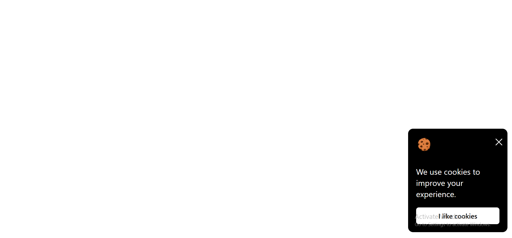

# Cookie Consent

A cookie consent popup built with HTML, CSS, and vanilla JavaScript for the [roadmap.sh Cookie Consent project](https://roadmap.sh/projects/cookie-consent).

This project helped me practice building a UI from a reference, handling button clicks, and remembering a user's choice with `localStorage`.

## Preview

## Features

- Black popup with a cookie illustration, a close button, and a white accept button.
- Fixed positioning in the bottom-right corner of the browser window.
- Clicking **I like cookies** hides the popup and saves the choice.
- Consent persists across page refreshes and browser restarts in the same browser profile, until site storage is cleared.
- Clicking **X** dismisses the popup for the current page view without saving consent.

## How I implemented it

### HTML: structure

The popup groups a header, a message, and an accept button. The header contains the cookie image and a close button with an accessible label. The stylesheet is linked in the document head, and the script uses `defer` so the HTML is parsed before JavaScript accesses its elements.

### CSS: layout and styling

`position: fixed`, `bottom`, and `right` place the popup in the corner. Padding creates space inside the card, while rounded corners soften the popup and button. The header uses Flexbox with `space-between` and `flex-start` to separate the cookie and close button. Paragraph margins control the vertical spacing, and the accept button fills the available content width. A system font stack keeps the typography consistent without an external font download.

### JavaScript: interaction and persistence

I select the popup and both buttons with `getElementById()` and attach click listeners with `addEventListener()`.

When the user accepts, the handler hides the popup with `style.display = "none"` and calls `localStorage.setItem("acceptCookies", true)`. Local storage converts that boolean into the string `"true"`.

When the script runs on a later visit, `localStorage.getItem("acceptCookies")` reads the saved value. If it equals `"true"`, the popup is hidden. The close button only hides the popup; it does not write to storage.

## Run locally

Download or clone the repository and serve this folder with a local development server, such as VS Code Live Server. Open `index.html` through that server. No dependencies or build step are needed.

Use the same local address and port when testing saved consent because browser storage is specific to an origin.

## Manual checks

1. On a fresh origin, confirm the popup appears.
2. Click **I like cookies** and confirm it disappears.
3. Refresh and confirm it stays hidden.
4. In DevTools, open **Application → Local Storage** and delete the `acceptCookies` entry, then refresh. The popup should return.
5. Click **X**, then refresh. The popup should return because closing does not save consent.

These are steps for reproducing the behavior; they are not an automated test suite.

## Files

- `index.html` — popup markup.
- `style.css` — layout, spacing, colors, and typography.
- `script.js` — accept, dismiss, and saved-choice behavior.
- `cookie.png` and `x.svg` — visual assets.
- `assets/screenshot.png` — project screenshot.

## What I learned

- How fixed positioning differs from normal document flow.
- How Flexbox aligns the header elements.
- How padding, margins, font size, and content determine the card's layout.
- How click events connect HTML controls to JavaScript behavior.
- Why values read from `localStorage` must be compared as strings.

## Scope and next steps

This is a frontend learning exercise: it remembers a UI choice, but does not load or block analytics scripts or set actual cookies. Future improvements could include fitting very narrow screens and preventing a brief popup flash before saved consent is checked.

## References and assets

- [Project requirements on roadmap.sh](https://roadmap.sh/projects/cookie-consent).
- [Repository shared as a reference](https://github.com/EstebanPajaroDev/cookies.github.io).
- The cookie PNG and close SVG are included from my local project. Their original source and reuse terms should be recorded when available.
